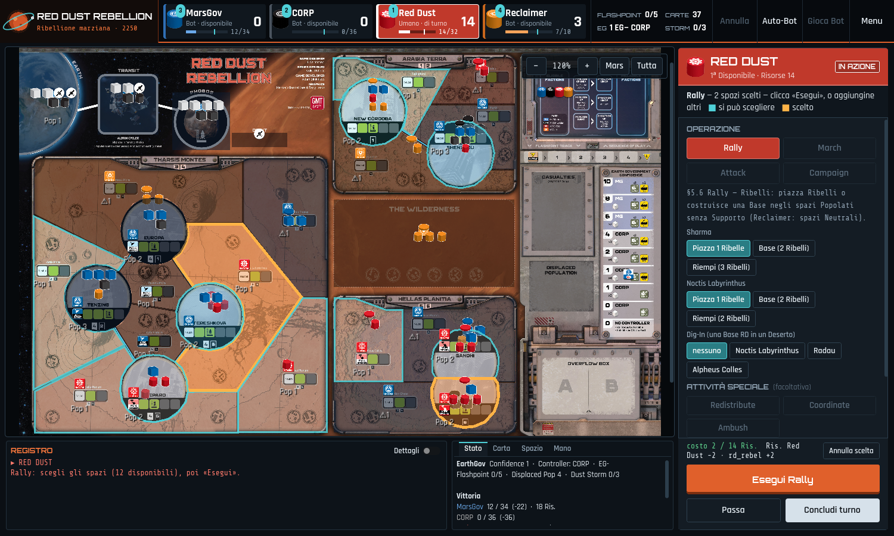

# COIN Engine (Godot 4)

Motore generico per la **serie COIN** di GMT Games + modulo **Cuba Libre**.
Progetto Godot 4.3.

## Architettura

```
coin_engine/        MOTORE COIN GENERICO (riusabile per altri giochi COIN)
  CoinEnums.gd        enumerazioni comuni
  PieceTypeDef.gd     definizione tipo di pezzo (cube/guerriglia/base, stati)
  FactionDef.gd       definizione Fazione
  SpaceDef.gd         definizione spazio mappa
  GameDef.gd          definizione completa del gioco (immutabile)
  SpaceState.gd       stato mutabile di uno spazio (pezzi, supporto, controllo, marker)
  GameState.gd        stato mutabile della partita (+ Controllo, Supporto/Opposizione)
  RulesModule.gd      interfaccia che ogni gioco COIN implementa

games/
  cuba_libre/
    CubaLibreModule.gd   modulo concreto: dati, tipi di pezzo, setup, vittoria
    data/                spaces / factions / setup / cards (JSON)

tests/
  test_runner.gd      test headless (validano dati, setup, controllo, vittoria)

scenes/               interfaccia grafica (fase successiva)
```

Il principio è la separazione tra **motore generico** (meccaniche comuni a tutti i COIN:
spazi, fazioni, pezzi con stati, Controllo, Supporto/Opposizione, sequenza a carte,
round periodici, framework di vittoria) e **modulo di gioco** (dati e regole specifiche).
Per implementare un altro gioco COIN basta aggiungere `games/<gioco>/` con il suo
`RulesModule` e i dati.

## Eseguire i test (headless)

```bash
# prima importazione del progetto (genera la cache delle classi globali)
godot4 --headless --path godot --import

# esecuzione dei test
godot4 --headless --path godot -s res://tests/test_runner.gd
```

Esce con codice 0 se tutti i test passano.

## Aprire nell'editor

Aprire la cartella `godot/` come progetto in Godot 4.3+.

## Interfaccia di gioco

Schema comune ai giochi COIN (lo stesso di Cuba Libre), con il tema
«plancia di controllo di una colonia marziana, 2250»:



* **Barra superiore** (`scenes/TopBar.gd`): emblema e titolo; una tessera per
  Fazione con ordine sulla carta, Umano/Bot e stato nella sequenza, Risorse (per
  le Corporations i Profits, per i Reclaimer le Asset card in mano, per i bot i
  loro contatori §8.5.4) e barra di Vittoria con la tacca della soglia
  (`MeterBar.gd`); i contatori Flashpoint, carte nel mazzo, EarthGov Confidence
  (valore, EG+/EG−, Controller) e Dust Storm Round (con l'avviso Haboob); i
  comandi Annulla, Auto-Bot, Gioca Bot e **Menu** (salvataggi, Log negli appunti
  o sulla Scrivania, bot fino al proprio turno, nuova partita, menu iniziale).
* **Mappa** al centro, con lo zoom sopra (−, %, +, «Mars» = la superficie,
  «Tutta» = la tavola con tracciati, Campaign e Capability).
* **Pannello azione** a destra (`Main.gd`, `_build_action_panel`): intestazione
  nel colore della Fazione di turno, istruzioni, poi Operazione, Attività
  Speciale (un tasto ciascuna, Ambush compresa), Operazioni gratuite concesse
  dagli Eventi, Evento (carta in corso, opzioni «Non ombreggiato» /
  «Ombreggiato» e, durante l'Evento, le sue scelte a tasti), Mano dei Reclaimer
  nel loro turno. In fondo il tasto contestuale («Esegui Rally», «Conferma
  spazi», «Esegui Evento non ombreggiato», «Gioca il turno di…», «Ho finito»
  nella Support Phase), «Passa» e «Concludi turno» (a carta chiusa «Concludi
  carta»).
* **In basso** il Registro con «Dettagli» (`BottomStrip.gd`) e, accanto, le
  schede Stato, Carta, Spazio e Mano.

**Una Operazione e una Attività Speciale per turno** (§4.1, §6.0): eseguire
un'Operazione non chiude più il turno. La si può proseguire in altri spazi
(mai due volte nello stesso), le si affianca al massimo un'Attività Speciale
(mai con l'Operazione Limitata), e il turno si chiude con «Concludi turno»
(`GameController.end_turn()`, che registra Op, Op + Attività Speciale o Op
Limitata). A turno iniziato niente Passo né Evento. I vincoli sopravvivono ad
Annulla e salvataggi; il test è `test_one_action_per_turn` in
`tests/test_runner.gd`.

Colori, caratteri (Orbitron, Share Tech Mono, Rajdhani: OFL, in
`assets/fonts/` con le licenze), riquadri ed emblema stanno tutti in
`scenes/RDRTheme.gd`: per un altro COIN basta cambiare quel file.

### Screenshot

`tools/screenshot.gd` fotografa l'interfaccia (serve un display: `xvfb-run`):

```bash
xvfb-run -a -s "-screen 0 1600x950x24" godot47 --path godot --rendering-method gl_compatibility --resolution 1500x900 -s res://tools/screenshot.gd -- out.png rally
```

Modi: nessuno (turno del Red Dust), `rally`, `rally-eseguito`, `evento`,
`bot`, `reclaimer`, `menu`. Un terzo argomento `piccolo` (con
`--resolution 1180x650`) prova il canvas logico dell'iPad.
